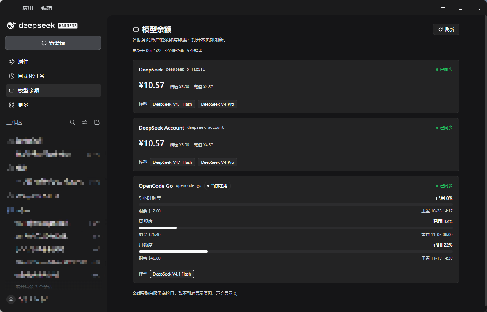

# 模型余额面板 · dsh-model-balance-panel

[](LICENSE)
[](https://github.com/qianhuang0721/dsh-model-balance-panel/releases)
[](https://github.com/qianhuang0721/dsh-model-balance-panel)

给 [DeepSeek Harness](https://github.com/deepseek-ai/deepseek-harness)（DSH）的 Web 界面加一个**左侧栏入口**，
点开就能看到 **DSH 里已配置的那些模型服务商各自还剩多少钱、还剩多少额度**。
余额来自各服务商自己的账户接口，**每次进入面板都会刷新**。

> 非官方插件，与 DeepSeek 官方无关。余额数字来自第三方接口，仅供参考，以服务商账单为准。



## 它显示什么

- **左栏图标**：钱包字形，排在「插件」「定时」之后；点开即切到余额面板。
- **每个服务商一张卡片**，卡片上是它的**模型清单**（当前在用的模型高亮），下面是该服务商的余额：
  - 订阅 / 额度制（如 OpenCode Go）：**5 小时额度、周额度、月额度** 三条进度条，
    显示已用百分比、按满额度折算的剩余金额、重置时间；≥70% 变黄、≥90% 变红。
  - 金额制（DeepSeek API Key / DSH 登录账号）：可用余额，以及赠送、充值两个分项。
- **状态如实**：`已同步` / `未配置凭证` / `不支持查询` / `查询失败`（附原因）。
  取不到就是取不到，**不会显示一个假的 0**。
- **进入即刷新**：面板挂载时自动拉一次；右上角另有「刷新」按钮。宿主侧 5 秒内复用快照并合并并发请求，
  连点刷新不会打爆上游接口。

## 支持的服务商

| provider id | 余额来源 | 展示 |
| --- | --- | --- |
| `opencode-go` | `GET https://opencode.ai/zen/go/v1/usage` | 5 小时 / 周 / 月 三窗口 |
| `commandcode` | `GET https://api.commandcode.ai/alpha/*`（whoami / credits / subscriptions / usage） | 月额度（含剩余金额），有 `windowLimits` 时补 5 小时 / 周窗口 |
| `deepseek-official`、`deepseek` | `GET https://api.deepseek.com/user/balance` | 账户金额 |
| `deepseek-account` | `ctx.deepseekAccount.getBalance()`（无 API Key，走登录态） | 账户金额 |

没有余额接口的服务商**不会从面板上消失**：卡片会写明「不支持查询」。
加一个服务商只需要在 `index.js` 的 `PROVIDERS` 里加一条定义（id + 凭证引用 + 取数函数），
浏览器半侧不用动。

> `deepseek-official` 与 `deepseek-account` 是两条独立路由，按各自账户算钱，金额通常不相同：
> 前者扣 API Key 所属的开放平台账户，后者扣你在 DSH 里登录的账号。

## 安装

**应用内（推荐）**：设置 → 插件 → 从 Git / 本地目录安装，填入本仓库地址或本地路径。

**命令行**：

```bash
dsh plugin --profile <你的 profile> add "git+https://github.com/qianhuang0721/dsh-model-balance-panel.git#v0.1.0"
```

桌面端请用应用自己的插件管理器安装，profile 名一般是 `desktop`；`dsh web` 通常是 `web`。
安装后刷新页面即可看到左栏图标，无需构建步骤——本包没有依赖，也没有安装脚本。

## 使用

1. 点左侧栏的钱包图标 → 面板自动刷新一次。
2. 卡片按 DSH 里实际注册的服务商生成：DSH 的模型选择器里有什么，这里就有什么。
3. 看到「未配置凭证」：到 设置 → 模型 里给该服务商填 API Key（凭证名见下表）；填完回面板点「刷新」。

| 服务商 | 需要的凭证（环境变量名 / DSH 凭证引用） |
| --- | --- |
| `opencode-go` | `OPENCODE_GO_API_KEY` |
| `commandcode` | `COMMANDCODE_API_KEY` |
| `deepseek-official` | `DEEPSEEK_API_KEY` |
| `deepseek-account` | 无，登录 DSH 账号即可 |

## 工作原理

```
浏览器（client.js）                        宿主（index.js）
  sidebar.panellist 图标  ──点击──▶  main 面板
        │                                    │
        └── GET /dsh-model-balance-panel/snapshot ──▶  组装快照
                                                     ├─ ctx.llm.listProviders() / listModels()
                                                     ├─ agentDefaultModel.currentSelection()
                                                     ├─ ctx.credentials.resolve(凭证引用)
                                                     └─ 各服务商账户接口（Bearer，20s 超时 + 重试）
```

- **服务商与模型清单**取自 DSH 自己（`ctx.llm.*`、`agentDefaultModel`），所以面板不会凭空出现
  DSH 里没有的模型。
- **凭证只用于一次上游请求**：经 `ctx.credentials.resolve()` 解析，解析不到才回落到进程环境变量；
  **API Key 不进响应、不进页面、不落盘**。
- **快照路由只返回数字**，与页面同源，未额外加鉴权；GET-only，`no-store`。

## 目录结构

```
index.js          宿主半侧：GET /dsh-model-balance-panel/snapshot（5 秒复用，?force=1 强刷）
client.js         浏览器半侧：sidebar.panellist 图标 + main 面板（进入即刷新）
cordis.patch.yml  bundle patch：插入本插件行（行 id 与包名一致）
locale/zh.json    插件页显示的中文标题与描述
locale/en.json    英文标题与描述
icon.svg          插件图标
```

## 兼容性

- DSH `>= 0.2.1-rc.3`（写在 `package.json` 的 `engines.dsh`；在 0.2.1-rc.3 上实测）。
- Node.js `>= 22.12.0`（用到全局 `fetch` 与 `AbortSignal.timeout`）。
- 只依赖 DSH 的公开扩展点：`ctx.webServer`、`ctx.llm`、`ctx.credentials`、`agentDefaultModel`，
  以及浏览器侧的 `ctx.slots` / `ctx.locale`。**不 import 任何 `@deepseek-ai/*` 运行时包**，
  所以 DSH 升级不会因为 peer 依赖对不上而整行消失。

## 开发

```bash
node --check index.js && node --check client.js
```

宿主半侧改动需要把插件行关闭再开启（或重启 DSH）；浏览器半侧改动刷新页面即可。
新增服务商：在 `index.js` 的 `PROVIDERS` 里加一条，并在上面的表格里补一行。

## 隐私

本插件只读取**余额与额度数字**，不读取对话、不采集遥测、不发送任何统计数据。
上游请求只包含鉴权头与必要的查询参数。

## 致谢

余额窗口的接口口径与解析思路参考了 [dsh-pet](https://github.com/PC2005-cloud/dsh-pet)（MIT）。

## License

[MIT](LICENSE) © 2026 qianhuang0721
